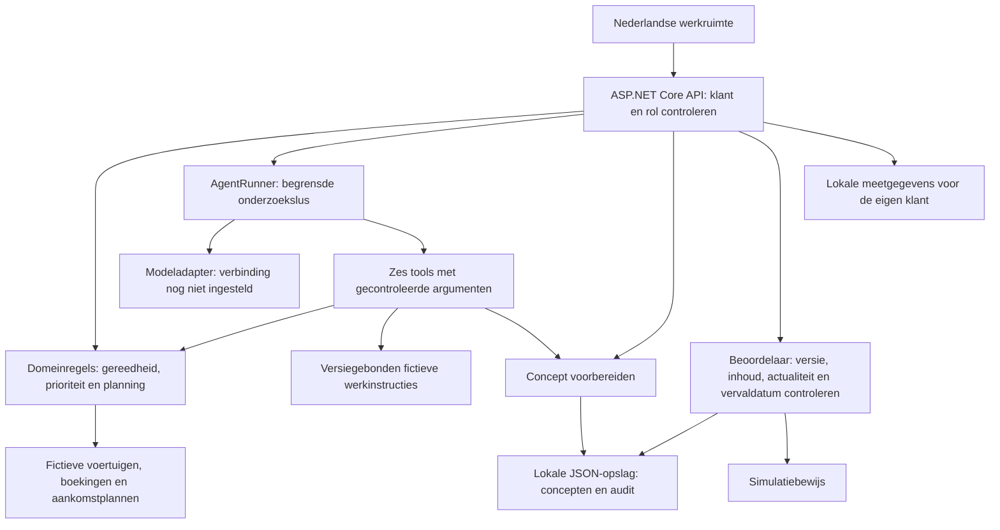

# PortOps uitleggen en demonstreren

## Uitleg in 30 seconden

> PortOps is mijn onafhankelijke portfolio-app voor voertuiglogistiek op een RoRo-terminal: een terminal waar voertuigen op en van schepen rijden. Je ziet welke voertuigen aandacht vragen, waarom ze geblokkeerd zijn en welke bronnen dat ondersteunen. Je kunt een planning bekijken en een statusbericht voorbereiden dat een aparte beoordelaar controleert. De agentlaag is gebouwd om dezelfde gegevens via zes afgebakende tools te onderzoeken. De huidige demo gebruikt fictieve gegevens; de echte modelverbinding en modelevaluatie staan nog open.

## Het probleem en het voorbeeld

Een medewerker krijgt de vraag: “Kan de transporteur DEMO-003 ophalen?” Alleen weten dat een voertuig op de terminal staat, is onvoldoende. Er kan nog een schadebeoordeling, inspectie of vrijgavecontrole openstaan. PortOps toont de blokkade, de verantwoordelijke en de ondersteunende bron. Als een afrondingstijd ontbreekt, blijft die onbekend.

Daarna kan de medewerker een conceptbericht voorbereiden. Een beoordelaar leest de volledige inhoud en bronnen en keurt precies die versie goed. De demo registreert een gesimuleerde verzending met auditlog; er gaat geen e-mail uit.

## Hoe de code samenwerkt

| Onderdeel | Waar je het vindt | Wat het aantoont |
| --- | --- | --- |
| Domeinregels | `src/PortOps.Domain/Operations.cs` | Afhaling en laden apart beoordelen; blokkades en bronkwaliteit bewaken |
| Planning | `src/PortOps.Domain/Planning.cs` | Voorraad en expliciete inkomende volumes apart tellen |
| Agent en tools | `src/PortOps.Agent/` | Onderzoek begrenzen en uitsluitend gecontroleerde tools aanbieden |
| API en identiteit | `src/PortOps.Api/Program.cs` | Klantomgeving en beoordelaarsrol op de server afdwingen |
| Menselijke controle | `src/PortOps.Domain/Proposals.cs` | Exacte versie en inhoud controleren vóór simulatie |
| Monitoring | `src/PortOps.Api/LocalMonitoring.cs` | Aanvragen correleren zonder berichtinhoud of toegangscodes op te slaan |
| Softwaretests | `tests/PortOps.Tests/` | Regels, klantscheiding, fouten en gelijktijdige goedkeuring controleren |
| Modelevaluatie | `evals/scenarios.json` | Tien voorbereide gevallen; echte modelresultaten nog niet gemeten |

## Demonstratiescript van ongeveer vijf minuten

1. **Context, 30 seconden.** Toon het fictieve scenario en leg uit dat operationele tijd vaststaat. Concepten verlopen volgens de werkelijke tijd.
2. **Planning, 60 seconden.** Toon 6 voorraadvoertuigen, 2 gereed voor afhaling en 3 met een blokkade. Er zijn 12 bekende inkomende voertuigen plus een plan met onbekend volume. Tel die niet op tot een voorraadprognose. Schakel naar 1 dag en toon het kleinere aankomstvenster.
3. **Onderzoek, 60 seconden.** Selecteer DEMO-003. Toon de schadeblokkade, het schadeteam, de onbekende afronding en de bron. Open de fictieve werkinstructies. Benoem dat aankomst of lossing op zichzelf geen afhaalvrijgave betekent.
4. **Controle, 90 seconden.** Maak een nieuw concept. Meld aan als beoordelaar, lees de volledige inhoud en bronnen, vink de controle aan en simuleer de verzending. Toon het auditlog en simulatiebewijs. Een verlopen concept moet eerst een nieuwe versie krijgen.
5. **Engineering en grens, 60 seconden.** Toon de monitoring en het bovenstaande schema. Benoem de 127 geslaagde softwaretests en de nog niet uitgevoerde echte modelevaluatie. Het vraaggesprek is uitgeschakeld zolang geen model is ingesteld.

Gebruik voor een opname een nieuw fictief concept en toon nooit toegangscodes, providersleutels of gebruikersgeheimen. De route in de browser moet nog volledig visueel worden gecontroleerd voordat deze handleiding als opnamechecklist wordt afgevinkt.

## Antwoorden op vragen van een beoordelaar

**Wat maakt dit meer dan een chatvenster?** De waarde zit in het operationele model, herleidbare bronnen, klantscheiding, controle van acties en de meetbare uitvoering. De chatlaag gebruikt dezelfde domeinservices als het gewone scherm.

**Waarom berekent het model niet zelf de gereedheid?** De regels zijn reproduceerbaar en afzonderlijk te testen. Een model mag een openstaande blokkade niet wegredeneren. Het kiest tools en formuleert uitleg; de server bewaakt de operationele beslissingen.

**Is een antwoord met bronnen automatisch juist?** Nee. De code controleert of bronverwijzingen werkelijk zijn opgehaald. Of elke bewering ook uit die bron volgt, moet in de modelevaluatie worden beoordeeld.

**Waarom twee rollen?** De operator bereidt voor; de beoordelaar beslist. Een modelinstructie kan de beoordelaarsrol niet toekennen. Goedkeuring hoort bij de exacte versie en inhoud, niet bij een los verzoek “verstuur maar”.

**Waarom nog geen echte terminalkoppeling?** De demo vereist geen toegang tot bedrijfsgegevens. Een echte koppeling vraagt toestemming, een beschikbare API of export, en afspraken over betekenis en actualiteit van velden. De huidige fixtures bewijzen geen compatibiliteit met een commercieel TOS.

**Is het product klaar voor productie?** Nee. Productie-identiteit, een geschikte database, echte berichtaflevering, operationele integratie en deploymentbeheer vallen buiten deze lokale portfolio-versie. Modelgedrag is nog niet live geëvalueerd.

## Wat je wel en nog niet kunt claimen

- Wel: een werkende lokale operationele demo met planning, bronnen, gecontroleerde concepten, simulatie, monitoring en 127 geslaagde softwaretests.
- Wel: een geïmplementeerde agentlus met zes tools, getest met gescripte modellen.
- Nog niet: bewezen nauwkeurigheid of weerstand tegen misleidende broninstructies van een echt model.
- Nog niet: een klantimplementatie, terminalpartnerschap, gemeten tijdsbesparing, echte TOS-integratie of productiegeschiktheid.

Zie [voortgang](progress.md), [demoroute](demo-walkthrough.md) en [architectuurkeuzes](architecture.md) voor details.
